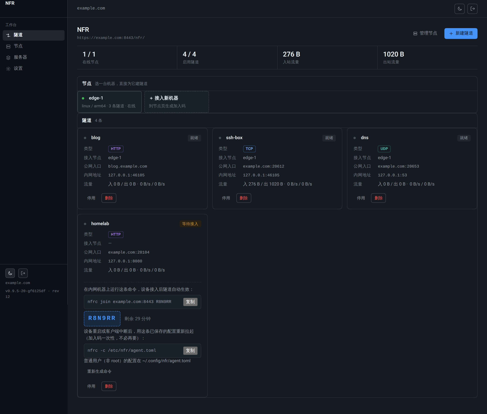
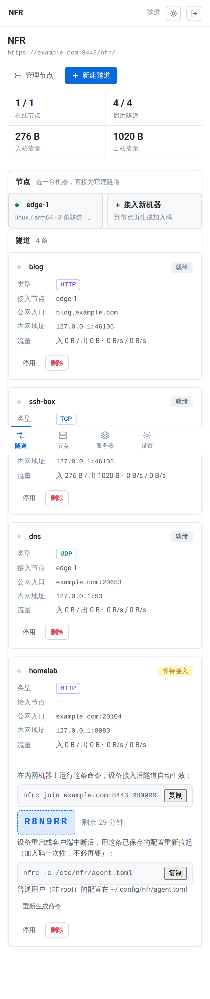

# NFR

**自托管的内网穿透 / 反向隧道工具。两个二进制，自带面板。**

NFR (Not FRP) 是 frp、ngrok 的开源替代品：把内网的服务暴露到公网服务器上，
不需要在客户端写配置文件、不需要手动开端口、不需要再装一个第三方面板。

- 公网机：`nfrs` —— 跑控制通道、面板和 REST API，HTTP 可以用独立端口直连
- 内网机：`nfrc join <server> <code>` —— 一条 6 位加入码完成接入，之后自动重连；
  加入码由建隧道时生成，所以设备接进来时隧道已经在等它了
- 管理：浏览器打开面板，所有隧道、节点、端口、证书都在里面创建
- 多机（可选）：A 机器的面板可以纳管 B、C 服务器，在一处管理全部隧道；不用就不出现

```
                 公网                       内网
  访客 ──▶ :20612 ────┐              ┌── nfrc ── localhost:8080
  访客 ──▶ :20613 ────┤              │
  浏览器 ─▶ :8443 ──▶  nfrs    ──────┤
  面板   ◀─ /nfr/    │   TLS+yamux  └── nfrc ── localhost:22
                      └─ 端口池 20000-29999 ──▶ 访客直连
  域名访问（可选）：:80/:443 按 Host / SNI 分流
```

## 为什么不用 frp

| | frp | NFR |
|---|---|---|
| 客户端配置 | 手写 `frpc.toml`，每台机器拷一份 | 一条 `nfrc join` 命令，配置由服务端下发 |
| 加入方式 | 永久 token 明文写在文件里 | 建隧道时就地得一条加入命令：6 位一次性加入码绑定到该隧道，30 分钟有效，删隧道即吊销 |
| 管理入口 | 无面板，改 TOML 重启 | 内置面板，改完立即生效，不用重启 |
| 多机管理 | 一台一台改配置文件 | 需要时在「服务器」页纳管，列表里卡片切换 |
| HTTP 访问 | 要绑域名或另配 vhost | 默认 `http://服务器IP:端口`，域名可选 |
| UDP | 支持 | 同样支持，且 TCP/UDP 端口独立可复用同一号码 |
| 端口分配 | 自己猜一个没被占的 | 「获取端口」按钮，服务端查占用后租给你（TCP/UDP 分开租） |
| 观测 | 另装 frps dashboard + Prometheus | 面板实时速率 + `/metrics` |

## 界面

面板是服务端渲染的，没有 npm、没有前端构建、没有 CDN。界面走"工具优先"路线：
浅色侧栏 + 1px 分隔线、内联统计条、隧道与节点用卡片排列（桌面两列，手机上单列，
不出现横向滚动）、连续曲率圆角、无阴影渐变，层级靠字重和灰度表达；
主色 `#0969da`，语义绿/红/橙只出现在状态上。所有颜色走 CSS
变量，深浅主题只换 token、不改组件结构；文字对比度按 WCAG 2.1 AA 校准。
右上角可切深色并记住选择，手机上是底部标签栏，数据每 4 秒自己刷新。




| 新建隧道 | 接入机器 |
|---|---|
|  |  |

<details>
<summary>更多截图：服务器纳管 / 设置 / 手机</summary>

> 以下截图为功能示意，配色以隧道页为准。

| 纳管另一台 | 设置与证书 |
|---|---|
|  |  |

| 手机上单列 | 登录 |
|---|---|
|  |  |

</details>

## 快速开始

不用先写配置文件。

### 1. 公网服务器

公网服务器上，一条命令从裸机到能用的面板：

```bash
curl -fsSL https://github.com/Solitudeit/nfr/releases/latest/download/install.sh \
  | sudo sh -s -- --systemd
```

它装好 `nfrs` / `nfrc`、写入 `/etc/systemd/system/nfr-server.service`、
`systemctl enable --now`，最后把 `systemctl status` 的一段打给你抄密码。
不加 `--systemd` 就只装二进制（内网机器用这个）。

第一次启动会自己写 `/etc/nfr/server.toml`、生成自签证书和管理员密码，日志里长这样：

```
  NFR 控制节点已就绪
  ────────────────────
  面板      https://203.0.113.10:8443/nfr/
  密码      k3m9xw2p
  证书指纹  3f:0e:...

  密码只显示这一次，登录后请在「设置」里修改。
```

不想用 systemd 就直接前台起一次：

```bash
sudo mkdir -p /etc/nfr && sudo nfrs -c /etc/nfr/server.toml   # 打印完自动转后台
sudo nfrs stop                                                # 改交给 systemd 前先停掉
```

⚠️ 两种方式不要同时跑——都监听 `control_listen`（默认 8443），后起的会
`bind: address already in use`。

> 也可以用 Docker 起，同样一条命令：
>
> ```bash
> docker run -d --name nfr --restart=always -p 8443:8443 -p 80:80 -p 443:443 \
>   -v nfr-data:/var/lib/nfr ghcr.io/solitudeit/nfr
> docker logs nfr      # 面板地址与密码
> ```
>
> 要接域名 + 80/443，或让 Let's Encrypt 签证书，改 `/etc/nfr/server.toml` 后重启即可，
> 细节见 [docs/deploy.md](docs/deploy.md)。
>
> 80/443 已经被 nginx / Caddy 占着？把 `http_listen` 改到 `127.0.0.1:8080`、
> `https_listen = "off"`，再跑 `nfrs proxy-config app.example.com` 生成反代片段贴进站点配置，
> 详见 [和已有的 nginx / Caddy 共存](docs/deploy.md#和已有的-nginx--caddy-共存)。

### 2. 内网机器

隧道由内网那台机器发起，服务器不代替它拨「内网地址」——所以在内网机器上接 agent：
面板「节点」页点「生成加入码」，把打印出来的那条命令粘到内网机器；
也可以直接在「隧道」页新建隧道时选「＋ 新设备」，保存后卡片上就给出绑定这条隧道的加入命令，设备一接入隧道自动生效。

```bash
nfrc join example.com ABC123
```

它记下证书指纹、换取长期令牌、写入 `/etc/nfr/agent.toml`，然后**直接保持连接**。
如果打印出来的命令里是本机地址，面板会同时提示——先去「设置」填「对外地址」
（公网 IP 或解析到这台机器的名字），再加入别的机器。
Ctrl-C 停止；交给 systemd 时先加 `--no-start`，再跑 `nfrc` 作为服务。
断线会自己重连（1s 起，指数退避到 30s），服务器重启后隧道照样恢复。

**重启也是同一条命令**：加入码只需用一次，之后不要重新 `join`（那会新建一个节点），
用已经写好的配置把客户端拉起来即可，重启机器、断线、换 systemd 都走这条：

```bash
nfrc -c /etc/nfr/agent.toml
```

（普通用户不是 root 时配置在 `~/.config/nfr/agent.toml`。）

`join` 结束时的输出、`--no-start` 的提示、以及面板上「等待接入」的卡片都会把这一行
印出来，不用记。

### 3. 建隧道

面板「隧道」→「新建隧道」。先选接入节点——已经接入的机器直接点它；机器还没接入
就点「＋ 新设备」，保存后隧道以「等待接入」停在列表里，卡片上给出绑定这条隧道的
加入命令，在那台机器上跑一次就自动生效：

- **HTTP**：填内网地址，点「获取端口」拿一个公网端口（如 `20612`），访客直接访问
  `http://你的服务器IP:20612`；想按域名分流再填域名，走 80/443，不占额外端口
- **TCP**：填内网地址和一个公网端口，适合 SSH、数据库这类非 HTTP 协议
- **UDP**：同样一个公网端口，原样转发 UDP 数据报——DNS、WireGuard、游戏、
  Syslog 都用它。每个访客地址在服务端固定到一条独立会话，回包原路返回；
  空闲 90 秒自动回收。TCP 和 UDP 端口空间独立，`tcp:53` 和 `udp:53` 可以共存

保存后 agent 立刻收到新配置，正在传输的连接不会断。

**限速与配额**（表单里的「限速与配额」区块）：

- **带宽限速**：单位 KB/s，上下行各自限到这个速度，整条隧道所有连接共享。
  512 KB/s ≈ 4 Mbps。令牌桶在服务端整形，不限速时零开销
- **月流量配额**：单位 MB，按自然月统计、月初自动清零。超出后隧道自动停用
  （列表里标「配额停用」），下月自动恢复——把服务器带宽借给朋友用，
  不用天天盯着账
- 已用流量每 30 秒落盘一次，重启最多丢 30 秒的记账，不会清零

## 本地 30 秒试玩

不需要公网服务器，也不需要 root（用高位端口）：

```bash
cat > /tmp/nfr-demo.toml <<'TOML'
control_listen = "127.0.0.1:18443"
http_listen    = "127.0.0.1:18080"
https_listen   = "off"
data_dir       = "/tmp/nfr-demo"
TOML

go run ./cmd/nfrs -c /tmp/nfr-demo.toml &           # 记下打印出来的密码

python3 -m http.server 8080 &                       # 一个假的内网服务

# 打开 https://127.0.0.1:18443/nfr/ → 新建隧道 → 选「＋ 新设备」，
# 内网地址填 8080、公网端口填 20612（或点「获取端口」），保存后卡片上会给出
# 这条命令（ABC123 换成卡片上的码）：
go run ./cmd/nfrc join -c /tmp/nfr-agent.toml 127.0.0.1:18443 ABC123 &

# 设备接入后隧道自动生效：
curl http://127.0.0.1:20612/
```

## 自托管面板

同一个进程，`/nfr/`：

- **隧道**：整个面板的主页。顶部统计条给出在线节点数、启用隧道数、进出流量；
  下面是节点选择条（点一台机器即为它建隧道，「＋ 接入新机器」给出绑定码）与隧道卡片——
  名称、类型、接入节点、公网入口（域名或 IP + 端口）、内网地址、流量与状态；
  桌面两列，手机上单列，不出现横向滚动。还没接入的设备会以「等待接入」卡留在列表里，
  卡上直接给出 `nfrc join` 命令、剩余有效时间和「重新生成命令」
- **节点**：卡片列出每台接入的设备，标明所在国家、系统、隧道数与最后心跳；
  可生成加入码、改名、移除（隧道跟着节点走，节点离线时隧道保留但不可用）。
  这里的加入码是「先接入、后建隧道」，一次性、5 分钟有效
- **服务器**：纳管其它 NFR 实例（填地址 + API 密钥即可；不配就默认隐藏）
- **设置**：实例名、域名、对外地址、端口范围、证书来源与到期、面板密码，以及 API 密钥
  （给自动化用的 read / write / admin 密钥，明文只显示一次）

### 隧道状态

一条隧道只有一种状态，且不含「在线」这种把隧道当成主机的说法：

| 状态 | 含义 |
| --- | --- |
| 就绪 | 节点连着，公网端口在听，随时可以转发 |
| 活跃 | 此刻有连接在转发 |
| 已停用 | 被手动关掉，公网端口不监听 |
| 配额停用 | 本月流量到达上限后自动关掉 |
| 节点离线 | 接入的机器断线，隧道保留配置但转发不了 |
| 需重新选择节点 | 隧道指向的节点已不存在，编辑它重新选一台 |
| 目标不可达 | 节点连着，但它拨不通内网地址（服务没起或端口写错） |

## 多服务器纳管

每台机器都是完整独立的实例；「纳管」只是浏览器里的一个 `?server=` 参数：
A 的面板通过 HTTPS 调用 B 的 REST API，把 B 的服务器卡片合并进同一个界面。
B 不用改配置，也不用信任 A 的数据库——B 的 state 永远在自己手里。

在 B 上：**设置 → 开放 REST API**，然后在同一页的「API 密钥」里建一个 key。
在 A 上：**服务器 → 添加服务器**，填 `https://B:8443` + key。
自签证书第一次会显示指纹，确认后钉住；之后指纹变了会直接拒连并告警。

## 安全模型

- 传输：TCP + TLS 1.3 + [yamux](https://github.com/hashicorp/yamux)，ALPN 区分隧道流量
  和普通 HTTPS；隧道流量也可以走 QUIC（预留，未启用）
- 身份：加入码一次性，绑定隧道的 30 分钟、节点页通用码 5 分钟，同 IP 错 5 次锁 15 分钟；
  长期令牌只存 SHA-256，校验用 HMAC 挑战应答，令牌本身不过网、不落盘明文
- 证书：自签默认 TOFU 钉指纹；配了域名可以走 ACME，对端改用系统根证书校验
- 面板：bcrypt 密码、HttpOnly + SameSite=Strict 会话、CSRF token、登录限流
- API：密钥只存哈希，默认关闭，可按来源 IP/CIDR 限制，scope 分 read/write/admin

## 配置

服务端 `/etc/nfr/server.toml`（首次启动自动生成）：

```toml
control_listen = ":8443"     # 控制通道 + 面板 + API
http_listen    = ":80"       # HTTP 隧道入口
https_listen   = ":443"      # HTTPS 隧道入口（可设成 "off"）
data_dir       = "/var/lib/nfr"
domain         = "example.com"
port_range     = [20000, 29999]
log_level      = "info"

[acme]
enabled = false
email   = "you@example.com"
# ca = "https://acme-staging-v02.api.letsencrypt.org/directory"
```

客户端 `/etc/nfr/agent.toml`（`nfrc join` 自动写入，一般不用手改）：

```toml
log_level = "info"

[[server]]
addr    = "example.com:8443"
node_id = "k3m9xw2p"
token   = "nfr_n_..."
pin     = "3f0e..."
```

隧道本身不在配置文件里——它们在面板和 `state.json` 里，这正是和 frp 最大的区别。

## REST API

面板用的就是这一套 API，`Authorization: Bearer nfr_...`：

| 方法 | 路径 | 说明 |
|---|---|---|
| GET | `/api/v1/info` | 实例信息、在线节点与隧道 |
| GET | `/api/v1/certs` | 证书来源、指纹、到期时间 |
| GET/POST | `/api/v1/tunnels` | 列表 / 创建 |
| GET/PATCH/DELETE | `/api/v1/tunnels/{id}` | 详情 / 修改 / 删除 |
| POST | `/api/v1/ports/allocate` | 申请一个公网端口（10 分钟租约） |
| GET/DELETE | `/api/v1/nodes[/{id}]` | 节点 |
| PATCH | `/api/v1/nodes/{id}` | 节点改名 |
| POST | `/api/v1/nodes/join-codes` | 生成一次性加入码 |
| GET/POST/DELETE | `/api/v1/servers[/{id}]` | 纳管实例 |
| GET/POST/DELETE | `/api/v1/api-keys[/{id}]` | API 密钥 |
| GET/PATCH | `/api/v1/settings` | 域名、端口池、API 开关 |
| GET | `/api/v1/events` | SSE 事件流 |

```bash
curl -H "Authorization: Bearer $NFR_KEY" https://example.com:8443/api/v1/tunnels
```

访问对面实例时加 `?server=<id>`，例如
`GET /api/v1/tunnels?server=k3m9xw2p` 会代理到被纳管的 B。

## 观测

`GET /metrics`（Prometheus 文本，需要 read 权限的 key）：

```
nfr_up 1
nfr_nodes_online 2
nfr_tunnel_bytes_total{id="k3m9",name="blog",direction="out"} 1.2e+06
nfr_tunnel_active{id="k3m9",name="blog"} 3
```

## 构建

```bash
make build            # 本机
make cross            # linux/amd64, linux/arm64, darwin/arm64, windows/amd64
make test             # go test ./...
python3 scripts/e2e.py            # 单实例端到端
python3 scripts/e2e_udp.py        # UDP 隧道端到端
python3 scripts/e2e_quota.py      # 限速与配额端到端
python3 scripts/e2e_federation.py # 双实例纳管端到端
```

只依赖标准库 + `yamux`、`toml`、`x/crypto`，没有 CGO。

## 状态与版本

- 状态：`<data_dir>/state.json`（0600，原子写入），统计只在内存里
- 版本：`nfrs version` / `nfrc version`，构建时 `-ldflags "-X .../version.Version=v0.1.0"`
- 兼容性：`state.json` 带 schema 版本，升级不会丢数据

## 路线图

- [x] 单端口多协议入口、面板、端口租约、加入码、多机纳管、Prometheus
- [x] UDP 隧道（每访客会话 + 空闲回收，TCP/UDP 端口空间独立）
- [x] 带宽限速（每隧道令牌桶，上下行各自封顶）与月流量配额（超额自动停用、跨月恢复）
- [x] 隧道优先的接入流程：建隧道时就地生成绑定加入码，设备接入即生效（概览页并入隧道页，
      面板收成四页）；客户端掉线时卡片直接给出 `nfrc -c` 重启命令
- [ ] WebSocket / gRPC 长连接的更多测试用例
- [ ] QUIC 传输（代码里已留接口，默认不启用）
- [ ] STCP 类私密隧道（访客侧也需要 agent）
- [ ] 多用户面板（注册、按用户隔离隧道与配额）

## License

MIT
