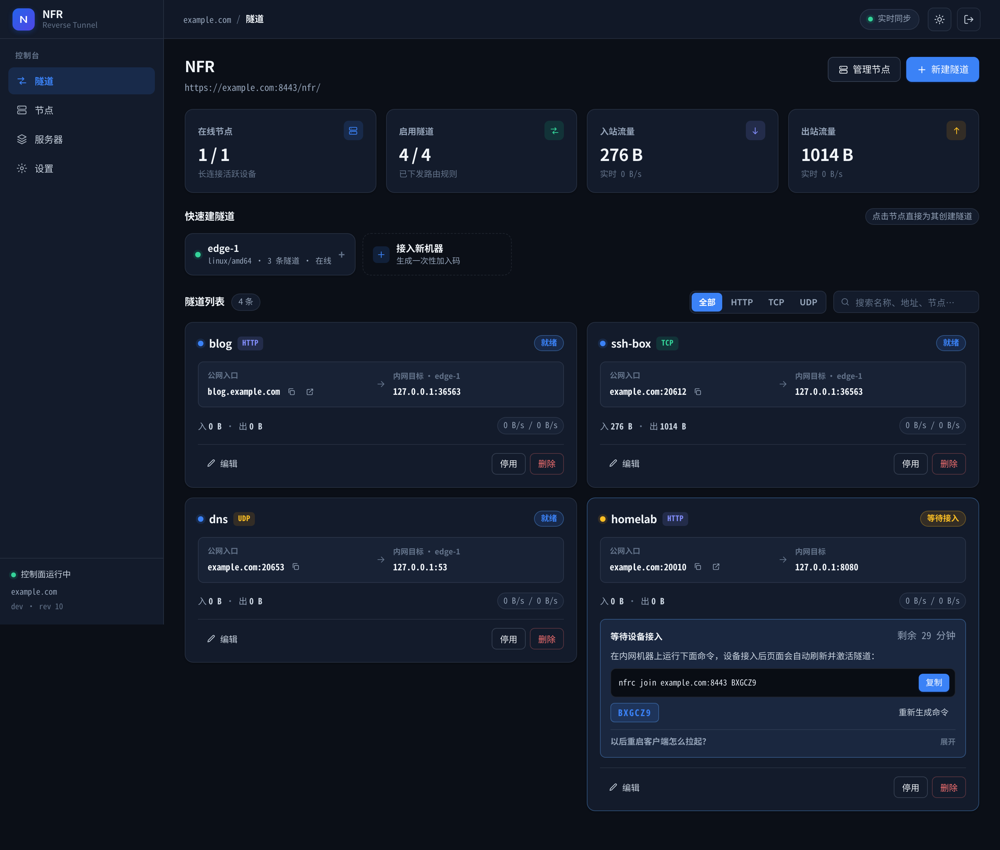
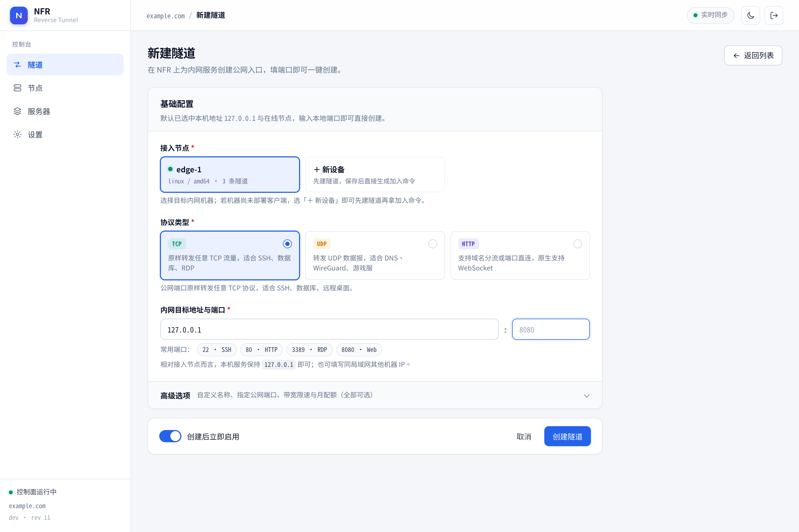
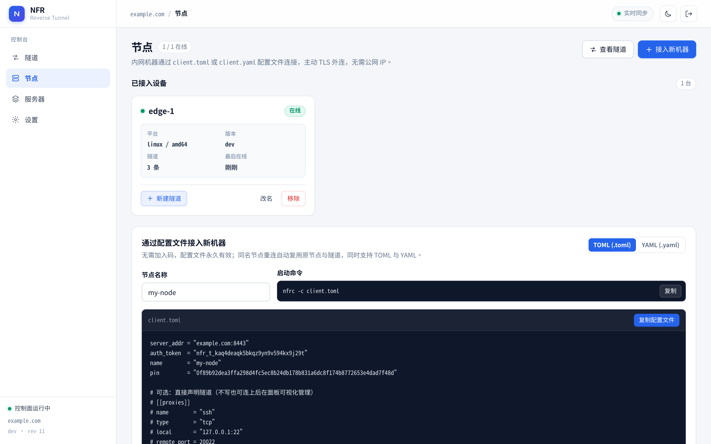
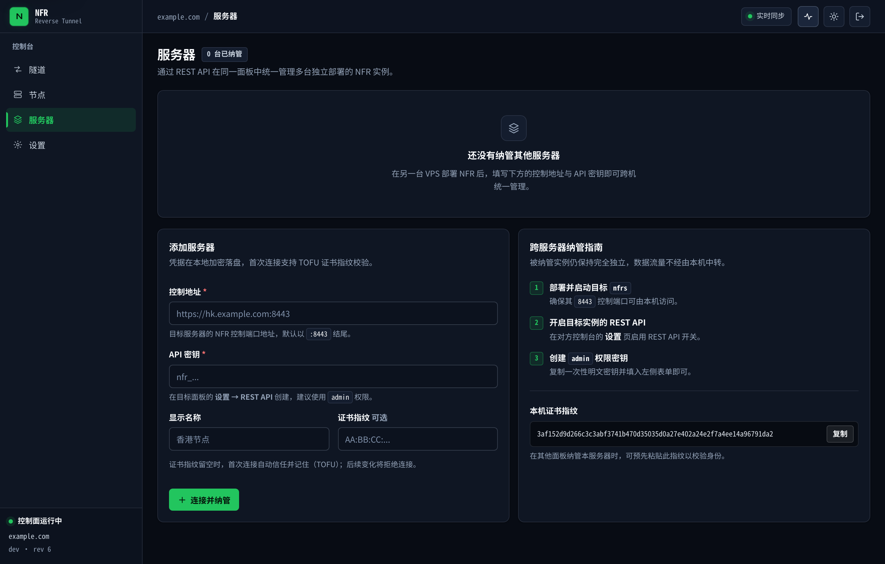
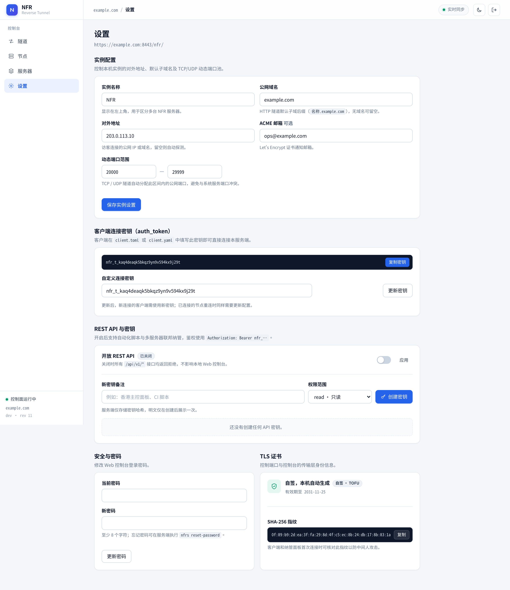
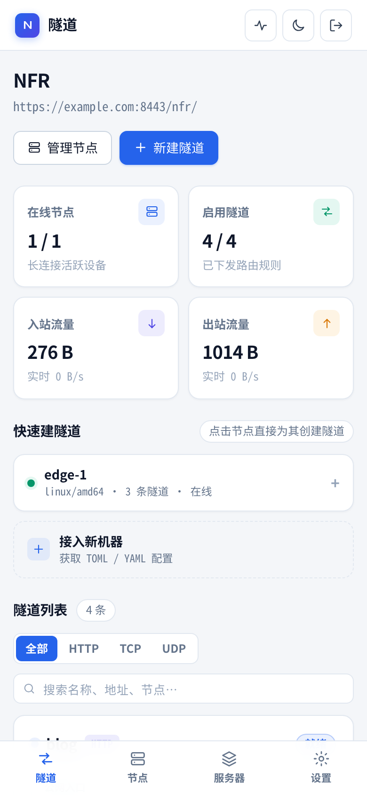
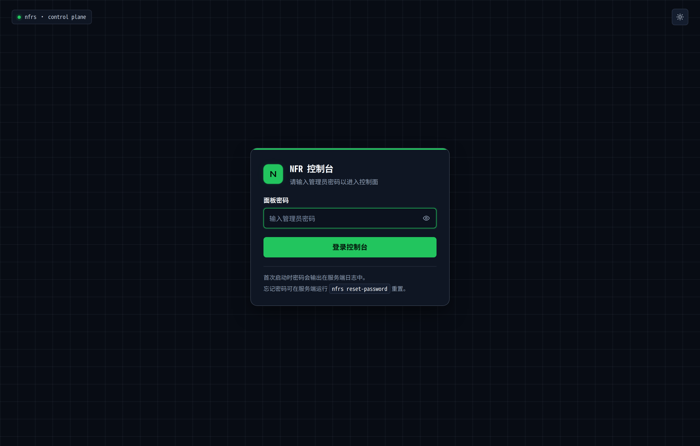

# NFR

[](https://github.com/Solitudeit/nfr/releases/latest)
[](https://github.com/Solitudeit/nfr/actions/workflows/ci.yml)
[](LICENSE)

**NFR** 是一个使用 Go 编写的自托管内网穿透 / 反向隧道工具，由服务端 `nfrs` 与客户端 `nfrc` 两个无 CGO 静态二进制组成，内置轻量级 Web 管理面板与 REST API。

相比传统纯静态配置文件的反向代理，NFR 将隧道规则集中在服务端管理：客户端通过一条一次性 6 位加入码完成接入后，隧道配置由服务端实时热推送，无需反复登录内网机器修改配置或重启进程。

```
                 公网                             内网
  访客 ──▶ :20612 (TCP/HTTP/UDP) ─┐        ┌── nfrc ──▶ 127.0.0.1:8080
  访客 ──▶ :80/:443 (Host/SNI)  ──┼─ nfrs ─┤   TLS 1.3 + yamux
  管理 ──▶ :8443 (/nfr/ & API)  ──┘        └── nfrc ──▶ 127.0.0.1:22
```

---

## 核心特性

- **双二进制开箱即用**：纯 Go 编译（无 CGO、无外部数据库、无前端构建依赖），所有状态持久化在单个原子写入的 `state.json` 中。
- **双格式配置文件驱动（TOML & YAML）**：服务端与客户端原生同时支持 `.toml` 与 `.yaml` / `.yml` 启动配置；通过共享 `auth_token` 直接接入，同名节点重连自动复用原节点，不依赖会过期的一次性加入码。
- **配置声明 + 面板管理双模式**：客户端既可以在 `client.toml` / `client.yaml` 中仅填 `server_addr` 与 `auth_token` 接入后在 Web 面板里可视化管理隧道，也可以在配置文件里直接声明 `proxies` 启动即生效。
- **多协议与连接复用**：
  - **TCP / UDP**：公网端口池自动分配（TCP 与 UDP 端口空间独立，如 `tcp:53` 与 `udp:53` 可共存），UDP 按访客会话转发并自动回收空闲会话。
  - **HTTP / HTTPS**：支持独立公网端口直连，或通过 `:80` / `:443` 按 `Host` / SNI 分流；基于标准 `httputil.ReverseProxy` 与按隧道复用的连接池，支持流式响应、Chunked 传输与 WebSocket (`101 Switching Protocols`)。
- **限速与流量配额**：支持单隧道上下行独立令牌桶限速，以及按自然月统计的流量配额（超额自动停用，次月自动恢复）。
- **多实例纳管（可选）**：每台 `nfrs` 均独立运行；需要时可在任意一台面板通过 HTTPS + API Key 纳管其他实例，集中切换管理，远端密钥在本地以 AES-256-GCM 加密存储。
- **运维友好**：采用标准前台进程模型，原生适配 `systemd`、Docker / Docker Compose，提供 `verify` 配置校验、`reset-password` 密码重置、`proxy-config` 反代片段生成与 Prometheus `/metrics`。

---

## 下载发行版

在 [GitHub Releases](https://github.com/Solitudeit/nfr/releases/latest) 页面按平台下载对应压缩包。每个压缩包均包含 `nfrs`、`nfrc`、`README.md`、`LICENSE`（Linux 发行包额外包含 `systemd/` 服务模板），并附带 `SHA256SUMS` 校验文件：

| 平台 | 架构 | 压缩包 |
| --- | --- | --- |
| **Windows** | x86_64 (64 位) | `nfr_<ver>_windows_amd64.zip` |
| **Windows** | ARM64 | `nfr_<ver>_windows_arm64.zip` |
| **Linux** | x86_64 (64 位) | `nfr_<ver>_linux_amd64.tar.gz` |
| **Linux** | ARM64 (aarch64) | `nfr_<ver>_linux_arm64.tar.gz` |
| **Linux** | ARMv7 | `nfr_<ver>_linux_armv7.tar.gz` |
| **macOS** | Apple Silicon (M 系列) | `nfr_<ver>_macos_arm64.tar.gz` |
| **macOS** | Intel (x86_64) | `nfr_<ver>_macos_amd64.tar.gz` |
| **Android** | ARM64 (Termux / ADB) | `nfr_<ver>_android_arm64.tar.gz` |

---

## 快速开始

### 1. 部署公网服务端 (`nfrs`)

#### 方式 A：Linux 一键安装脚本（systemd 托管）

可通过 `NFR_PASSWORD` 直接指定初始管理员密码（不传则自动生成随机密码并输出到日志及 `/var/lib/nfr/initial-password.txt`，首次登录成功后自动删除）：

```bash
curl -fsSL https://github.com/Solitudeit/nfr/releases/latest/download/install.sh \
  | sudo NFR_PASSWORD='change-me-now' sh -s -- --server --systemd
```

#### 方式 B：Docker / Docker Compose

同一镜像（`ghcr.io/solitudeit/nfr:latest`）同时内置 `nfrs` 与 `nfrc`，详见 [deploy/docker/compose.yml](deploy/docker/compose.yml)：

```bash
docker run -d --name nfr-server --restart=unless-stopped --network host \
  -e NFR_PASSWORD='change-me-now' \
  -e NFR_AUTH_TOKEN='my-shared-token' \
  -e NFR_PUBLIC_HOST='203.0.113.10' \
  -v nfr-data:/var/lib/nfr \
  ghcr.io/solitudeit/nfr:latest
```

#### 方式 C：通过 TOML 或 YAML 配置文件手动运行（Windows / macOS / Linux / Android）

解压对应平台的压缩包，自带 `configs/` 示例模板，按需修改 `server.toml` 或 `server.yaml` 后启动：

```bash
# TOML 格式
./nfrs -c server.toml

# YAML 格式（与 TOML 完全等价）
./nfrs -c server.yaml
```

启动后在浏览器打开 `https://<服务器IP或域名>:8443/nfr/` 登录管理面板。

> 如果公网服务器的 `80` / `443` 已被 nginx 或 Caddy 占用，可在配置中设置 `http_listen = "off"`、`https_listen = "off"`（或 `http_listen = "127.0.0.1:8080"` 并执行 `nfrs proxy-config app.example.com` 生成反代片段）。详见 [docs/deploy.md](docs/deploy.md)。

---

### 2. 配置并启动内网客户端 (`nfrc`)

在服务端配置（或面板 **节点 / 设置** 页）获取 `server_addr` 与 `auth_token`，编写 `client.toml` 或 `client.yaml`：

- **TOML 格式（`client.toml`）**：

  ```toml
  server_addr = "203.0.113.10:8443"
  auth_token  = "my-shared-token"
  name        = "nas-home"

  # 可选：直接声明隧道（不写也能连上后直接在 Web 面板里建隧道）
  [[proxies]]
  name        = "ssh"
  type        = "tcp"
  local       = "127.0.0.1:22"
  remote_port = 20022
  ```

- **YAML 格式（`client.yaml`）**：

  ```yaml
  server_addr: "203.0.113.10:8443"
  auth_token: "my-shared-token"
  name: "nas-home"

  proxies:
    - name: ssh
      type: tcp
      local: "127.0.0.1:22"
      remote_port: 20022
  ```

- **启动客户端**：

  ```bash
  ./nfrc -c client.toml    # 或 ./nfrc -c client.yaml
  ```

- **Docker 运行客户端（也可直接挂载配置文件）**：

  ```bash
  docker run -d --name nfr-client --restart=unless-stopped --network host \
    --entrypoint nfrc \
    -e NFR_SERVER='203.0.113.10:8443' \
    -e NFR_AUTH_TOKEN='my-shared-token' \
    -e NFR_NAME='homelab' \
    ghcr.io/solitudeit/nfr:latest
  ```

---

## 常用 CLI 命令

```bash
# 服务端（支持 .toml 与 .yaml / .yml）
nfrs -c /etc/nfr/server.toml                    # 前台启动（推荐由 systemd / Docker 托管）
nfrs -c /etc/nfr/server.yaml                    # 使用 YAML 配置启动
nfrs -d -c /etc/nfr/server.toml                 # 显式转后台运行（停止用 nfrs stop）
nfrs verify -c /etc/nfr/server.toml             # 校验配置语法、端口范围与证书路径
nfrs reset-password -c /etc/nfr/server.toml     # 重置面板管理员密码（可传入新密码或随机生成）
nfrs status -c /etc/nfr/server.toml             # 查看当前配置与面板地址
nfrs proxy-config app.example.com               # 输出 nginx 反向代理配置模板

# 客户端（支持 .toml 与 .yaml / .yml）
nfrc -c /etc/nfr/client.toml                    # 使用 TOML 配置启动
nfrc -c /etc/nfr/client.yaml                    # 使用 YAML 配置启动
nfrc verify -c /etc/nfr/client.toml             # 校验客户端配置
nfrc status -c /etc/nfr/client.toml             # 查看已配置的服务端与隧道数

# 卸载（仅移除二进制与 systemd unit，保留 /etc/nfr 与 /var/lib/nfr）
curl -fsSL https://github.com/Solitudeit/nfr/releases/latest/download/install.sh \
  | sudo sh -s -- --uninstall
```

---

## 界面预览

内置 Web 面板由 `nfrs` 直接提供（`/nfr/`），支持深浅色主题切换、移动端自适应与 4 秒状态轮询。




<details>
<summary>查看更多页面截图（新建隧道 / 节点 / 多机纳管 / 设置 / 移动端）</summary>

| 新建隧道 | 节点管理 |
| --- | --- |
|  |  |

| 多服务器纳管 | 设置与证书 |
| --- | --- |
|  |  |

| 移动端视图 | 登录页 |
| --- | --- |
|  |  |

</details>

---

## 配置与环境变量

配置优先级：**默认值 < TOML / YAML 配置文件 < `NFR_*` 环境变量 < CLI 参数**。完整示例见仓库 [configs/](configs/) 目录（[server.toml](configs/server.toml)、[server.yaml](configs/server.yaml)、[client.toml](configs/client.toml)、[client.yaml](configs/client.yaml)）。

### 服务端 `server.toml` / `server.yaml`

```toml
control_listen = ":8443"     # 控制通道 + Web 面板 + REST API
http_listen    = ":80"       # HTTP 域名隧道入口（可设为 "off"）
https_listen   = ":443"      # HTTPS 域名隧道入口（可设为 "off"）
data_dir       = "/var/lib/nfr"
auth_token     = "my-shared-token"  # 客户端共享连接密钥（留空自动生成）
domain         = "example.com"
public_host    = ""          # 无域名时对外展示的公网 IP / 主机名
port_range     = [20000, 29999]
log_level      = "info"

[acme]
enabled = false
email   = "you@example.com"
```

支持的环境变量：

| 变量名 | 说明 |
| --- | --- |
| `NFR_CONTROL_LISTEN` | 覆盖 `control_listen`（默认 `:8443`） |
| `NFR_HTTP_LISTEN` | 覆盖 `http_listen`（默认 `:80`） |
| `NFR_HTTPS_LISTEN` | 覆盖 `https_listen`（默认 `:443`） |
| `NFR_DATA_DIR` | 覆盖 `data_dir`（默认 `/var/lib/nfr`） |
| `NFR_AUTH_TOKEN` | 覆盖服务端 / 客户端共享连接密钥 `auth_token` |
| `NFR_DOMAIN` | 覆盖 `domain` |
| `NFR_PUBLIC_HOST` | 覆盖 `public_host` |
| `NFR_PORT_RANGE` | 覆盖 `port_range`（格式 `20000-29999`） |
| `NFR_PASSWORD` | 首次启动初始管理员密码（明文或 bcrypt 哈希，仅写哈希进 `state.json`） |
| `NFR_ACME_ENABLED` / `NFR_ACME_EMAIL` | 启用 ACME 自动证书及邮箱 |
| `NFR_TLS_CERT` / `NFR_TLS_KEY` | 指定自定义 TLS 证书和私钥路径 |
| `NFR_LOG_LEVEL` / `NFR_LOG_FILE` | 日志级别（`debug`/`info`/`warn`/`error`）与日志文件 |

### 客户端 `agent.toml`

由 `nfrc join` 自动生成（支持配置多个 `[[server]]` 同时连接多台公网服务器）：

```toml
log_level = "info"

[[server]]
addr    = "example.com:8443"
node_id = "k3m9xw2p"
token   = "nfr_n_..."
pin     = "3f0e..."
```

---

## 安全模型

- **传输安全**：控制通道与数据流全程走 **TLS 1.3 + yamux 多路复用**（开启 30s TCP KeepAlive 与双向心跳），通过 ALPN（`nfr/1` / `http/1.1`）在单端口上严格隔离隧道协议与 HTTPS 控制台。
- **证书校验**：默认自动签发自签证书并通过 TOFU 钉住 SHA-256 指纹；启用 ACME（Let's Encrypt）后自动按已配置域名动态签发证书（支持 HTTP-01 与 TLS-ALPN-01），客户端与多机联邦改用系统根证书校验。
- **身份与凭据**：
  - 加入码为一次性 6 位 Crockford Base32，支持过期失效与删除隧道即吊销，同来源 IP 连续失败 5 次锁定 15 分钟。
  - 节点长期令牌在服务端仅存 SHA-256 摘要，认证走 HMAC-SHA256 挑战应答，令牌本身不在重连握手中明文传输。
  - 面板使用 bcrypt 密码哈希、`HttpOnly + Secure + SameSite=Strict` 会话 Cookie、CSRF 校验与登录限流。
  - 多机联邦保存的远端 API Key 使用 `<data_dir>/secret.key`（`0600`）经 **AES-256-GCM** 加密后写入 `state.json`。

---

## REST API 与监控

REST API 默认关闭，可在面板 **设置 → 开放 REST API** 中启用，并创建不同权限（`read` / `write` / `admin`）的密钥，通过 `Authorization: Bearer nfr_...` 调用：

| 方法 | 路径 | 说明 |
| --- | --- | --- |
| `GET` | `/api/v1/info` | 实例信息、在线节点与隧道数 |
| `GET` | `/api/v1/certs` | 当前 TLS 证书来源、指纹与有效期 |
| `GET` / `POST` | `/api/v1/tunnels` | 查询 / 创建隧道 |
| `GET` / `PATCH` / `DELETE` | `/api/v1/tunnels/{id}` | 隧道详情 / 编辑 / 删除 |
| `POST` | `/api/v1/ports/allocate` | 申请一个公网端口租约（支持 `tcp` / `udp`） |
| `GET` / `PATCH` / `DELETE` | `/api/v1/nodes[/{id}]` | 节点列表 / 改名 / 移除 |
| `POST` | `/api/v1/nodes/join-codes` | 生成一次性加入码 |
| `GET` / `POST` / `DELETE` | `/api/v1/servers[/{id}]` | 管理纳管的远端 NFR 实例 |
| `GET` / `POST` / `DELETE` | `/api/v1/api-keys[/{id}]` | 管理 API 密钥 |
| `GET` / `PATCH` | `/api/v1/settings` | 读写实例设置 |
| `GET` | `/api/v1/events` | SSE 实时变更事件流 |
| `GET` | `/metrics` | Prometheus 格式指标（需 `read` 及以上权限密钥） |

操作已纳管的远端实例时，在请求 URL 加上 `?server=<remote_id>` 即可透明代理转发。

---

## 从源码构建与测试

需要 Go 1.26+（无 CGO 依赖）：

```bash
make build      # 编译本机 bin/nfrs 与 bin/nfrc
make release    # 打包全部 8 个平台发行压缩包及 dist/SHA256SUMS
make vet        # go vet ./...
make test       # go test ./...

# 端到端测试（需先 make build）
python3 scripts/e2e.py            # 单实例 HTTP / TCP / 隧道优先接入 / API / SSE / 重启恢复
python3 scripts/e2e_udp.py        # UDP 隧道会话与转发
python3 scripts/e2e_quota.py      # 带宽限速与月流量配额停用/恢复
python3 scripts/e2e_federation.py # 双实例联邦纳管与 TOFU 校验
```

更多部署与架构细节见 [docs/deploy.md](docs/deploy.md) 与 [docs/architecture.md](docs/architecture.md)。

## License

[MIT](LICENSE)
