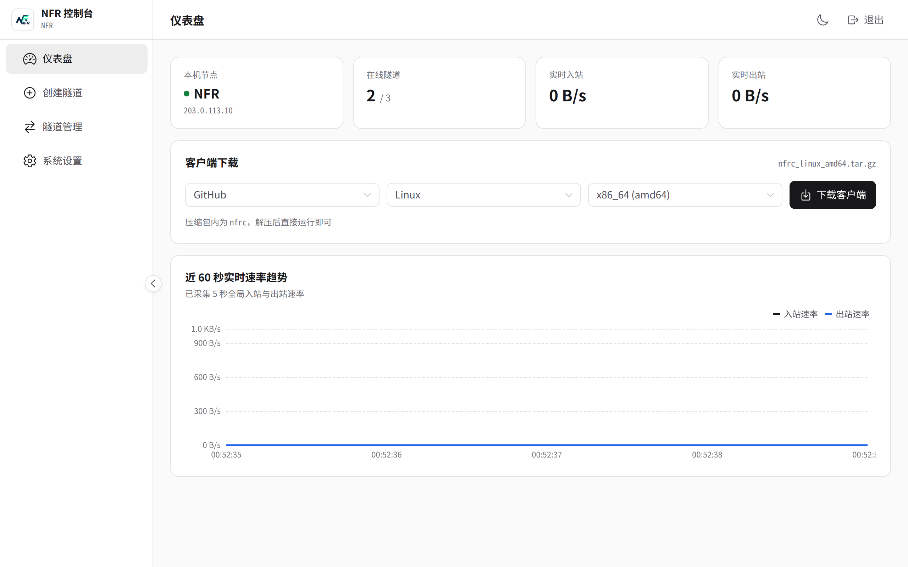
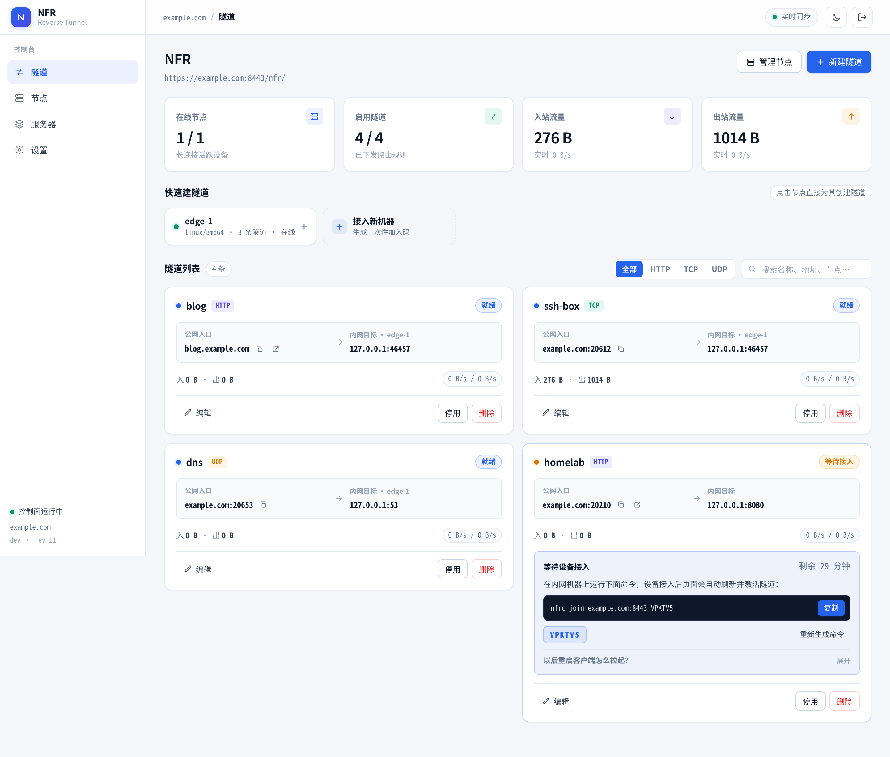

<div align="center">
  
  <h1>NFR</h1>
  <p>极简自托管内网穿透工具 · 单机二进制 · 内置现代 Web 控制台</p>

  <p>
    <a href="https://github.com/Solitudeit/nfr/releases">
      
    </a>
    <a href="https://github.com/Solitudeit/nfr/actions/workflows/ci.yml">
      
    </a>
    <a href="LICENSE">
      
    </a>
  </p>
</div>

---

**NFR** 由公网服务端 `nfrs` 与内网客户端 `nfrc` 组成，无 CGO、无外置数据库，单文件部署。内置 **Vue 3 + Naive UI** 极简控制台，开箱支持多协议转发、一键生成隧道配置、浏览器端镜像测速下载客户端与实时流量监控。

```text
公网访客 ──▶ :20022 (TCP/UDP/HTTP) ─┐          ┌── nfrc ──▶ 127.0.0.1:22
公网访客 ──▶ :80 / :443 (域名分流)  ─┼── nfrs ──┤  TLS 1.3 + yamux
管理后台 ──▶ :8443 (/nfr/ & API)   ─┘          └── nfrc ──▶ 127.0.0.1:8080
```

## 特性

- **极简 Web 控制台**：`仪表盘 · 创建隧道 · 隧道管理 · 系统设置` 四栏结构，深浅色主题与 3 套主色，移动端零溢出自适应，支持 **30 天服务端持久化免登录**。
- **开箱即用的隧道工作流**：面板创建隧道 → 弹窗一键复制/下载单隧道 `TOML / YAML` 配置 → 面板内直接按系统下载 `nfrc`（支持 **GitHub 直连** 与 **浏览器端自动测速优选镜像**）→ 一行命令上线。
- **全协议与治理**：支持 TCP / UDP / HTTP(S)（WebSocket 透明转发）、空闲端口自动分配、单隧道一键测通、强制下线、上下行独立限速与自然月流量配额。
- **蓝色移动端友好日志**：`nfrc` 采用 `HH:MM:SS [I]` 紧凑多行排版与 ANSI 蓝色终端配色，Termux 窄屏零折行，清晰呈现配置文件、`RunId` 与公网地址。
- **严格服务端隧道权限**：禁止客户端以任何旧配置私自创建服务端不存在的隧道，未在面板登记的隧道一律直接拒绝。
- **传输与凭据安全**：控制与数据通道全程 **TLS 1.3 + yamux**（客户端强制校验服务端证书：自签证书必填 `pin` 指纹，ACME / 公共 CA 证书设 `ca = true`），`HttpOnly + SameSite=Strict` 会话持久化哈希与 CSRF 校验。

## 界面预览

| 仪表盘 | 隧道管理（浅色） |
| --- | --- |
|  |  |

| 隧道管理（深色） | 移动端自适应 |
| --- | --- |
|  |  |

## 快速开始

### 1. 启动公网服务端 (`nfrs`)

前往 [GitHub Releases](https://github.com/Solitudeit/nfr/releases) 下载对应平台发行包，或使用 Docker 一行启动：

```bash
# 方式 A：直接运行二进制（支持 .toml 或 .yaml）
./nfrs -c server.toml

# 方式 B：Docker（预览版镜像）
docker run -d --name nfr-server --restart=unless-stopped --network host \
  -e NFR_PASSWORD='change-me-now' \
  -e NFR_PUBLIC_HOST='203.0.113.10' \
  -v nfr-data:/var/lib/nfr \
  ghcr.io/solitudeit/nfr:preview
```

启动后访问 `http://<公网IP>:8443/nfr/` 登录面板（初始密码打印在终端与 `/var/lib/nfr/initial-password.txt`，首次登录后自动清除）。

### 2. 创建隧道并启动客户端 (`nfrc`)

1. 在面板 **创建隧道** 填写名称、本地服务地址/端口与远程端口。
2. 在 **隧道管理 → 更多 → 生成启动配置** 中复制或下载 `nfrc-<名称>.toml`（或 `.yaml`）。
3. 在面板 **仪表盘** 或弹窗内选择操作系统与架构下载客户端（压缩包解压即得 `nfrc` / `nfrc.exe`），执行：

```bash
./nfrc -c nfrc-SSH.toml
```

客户端启动日志示例（终端显示为蓝色）：

```text
01:12:36 [I] 启动 NFR 客户端
  配置: nfrc-SSH.toml
01:12:36 [I] 连接节点
  地址: 203.0.113.10:8443
01:12:36 [I] 登录节点成功
  RunId: ffdrwvw0
01:12:36 [I] 隧道登记成功
  隧道: 90gv0gv9.SSH
01:12:36 [I] 启动 [tcp] 隧道成功
  公网: 203.0.113.10:20022
  本地: 127.0.0.1:22
```

## 平台支持

所有预发布版本均在 [GitHub Releases](https://github.com/Solitudeit/nfr/releases) 提供完整包（含 `nfrs` + `nfrc` + 配置模板 + `SHA256SUMS`）与精简客户端包（解压即 `nfrc` / `nfrc.exe`）：

| 平台 | 架构 | 精简客户端包 | 完整发行包 |
| --- | --- | --- | --- |
| **Windows** | amd64 / arm64 | `nfrc_windows_{amd64,arm64}.zip` | `nfr_<ver>_windows_{amd64,arm64}.zip` |
| **Linux** | amd64 / arm64 / armv7 | `nfrc_linux_{amd64,arm64,armv7}.tar.gz` | `nfr_<ver>_linux_{amd64,arm64,armv7}.tar.gz` |
| **macOS** | arm64 / amd64 | `nfrc_macos_{arm64,amd64}.tar.gz` | `nfr_<ver>_macos_{arm64,amd64}.tar.gz` |
| **Android** | arm64 (Termux) | `nfrc_android_arm64.tar.gz` | `nfr_<ver>_android_arm64.tar.gz` |

---

<details>
<summary><strong>常用命令、环境变量与配置示例</strong></summary>

### 常用 CLI

```bash
nfrs init -c server.toml              # 生成服务端配置模板（支持 .toml / .yaml）
nfrs -d -c server.toml                # 后台运行（停止：nfrs stop）
nfrs verify -c server.toml            # 校验配置语法
nfrs reset-password -c server.toml    # 重置面板管理员密码
nfrc verify -c client.toml            # 校验客户端配置
```

### 常用环境变量（服务端）

| 变量 | 说明 |
| --- | --- |
| `NFR_CONTROL_LISTEN` | 控制通道与面板监听地址（默认 `:8443`） |
| `NFR_HTTP_LISTEN` / `NFR_HTTPS_LISTEN` | HTTP / HTTPS 域名入口（可设为 `off`） |
| `NFR_PUBLIC_HOST` / `NFR_DOMAIN` | 对外展示的公网 IP 或域名 |
| `NFR_PORT_RANGE` | 公网端口池（如 `20000-29999`） |
| `NFR_PASSWORD` | 首次启动初始管理员密码（>= 8 位） |
| `NFR_AUTH_TOKEN` | 客户端共享连接密钥（留空自动生成） |
| `NFR_PANEL_HTTPS` | 设为 `true` 强制面板走 HTTPS（默认 `false`） |
| `NFR_MIRROR_PREFIXES` | 自定义客户端下载镜像节点列表（逗号分隔） |
| `NFR_DISABLE_SELF_UPDATE` | 设为 `1` 完全禁用服务端面板一键自升级 |

> **客户端 TLS 校验说明**：手写 `client.toml` / `client.yaml` 时，`pin`（服务端自签证书 SHA-256 指纹）与 `ca = true`（公共 CA / ACME 证书）**二选一必填**；通过面板生成配置或执行 `nfrc join` 会自动写入 `pin`。

完整配置示例见 [configs/](configs/)，进阶部署见 [docs/deploy.md](docs/deploy.md)。

</details>

<details>
<summary><strong>REST API 与 Prometheus 监控</strong></summary>

在面板 **系统设置 → 安全与接口** 启用 REST API 并签发密钥（`read` / `write` / `admin`），携带 `Authorization: Bearer <key>` 调用：

- `GET /api/v1/info` · `GET /api/v1/certs` · `GET /api/v1/events` · `GET /metrics`
- `GET / POST /api/v1/tunnels` · `PATCH / DELETE /api/v1/tunnels/{id}` · `POST /api/v1/ports/allocate`
- `GET / PATCH / DELETE /api/v1/nodes[/{id}]` · `GET / PATCH /api/v1/settings`

</details>

<details>
<summary><strong>从源码构建与测试</strong></summary>

需要 **Go 1.26+** 与 **Node.js 22+ / pnpm 12**：

```bash
pnpm --dir web install --frozen-lockfile
pnpm --dir web build
go build -trimpath -o bin/nfrs ./cmd/nfrs
go build -trimpath -o bin/nfrc ./cmd/nfrc

# 测试与端到端回归
go vet ./... && go test ./...
python3 scripts/e2e.py
python3 scripts/e2e_federation.py
```

</details>

## License

[MIT](LICENSE)
